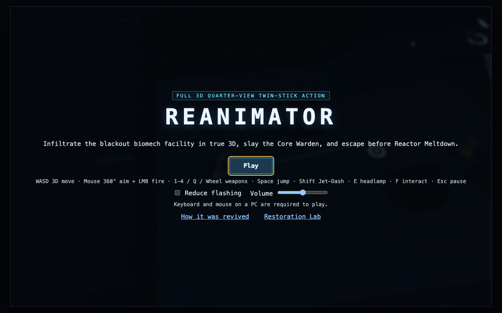
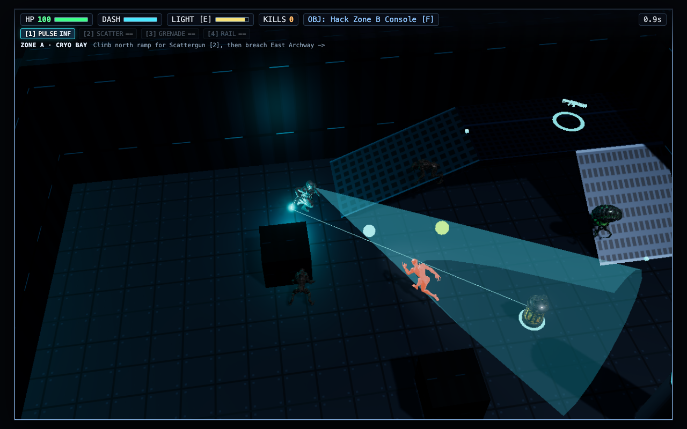
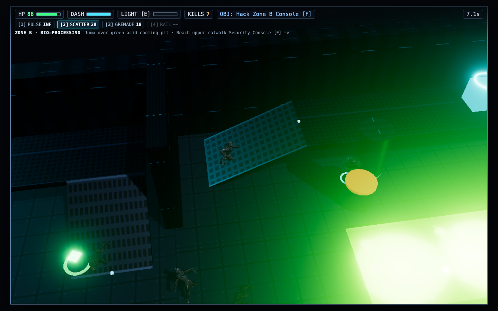
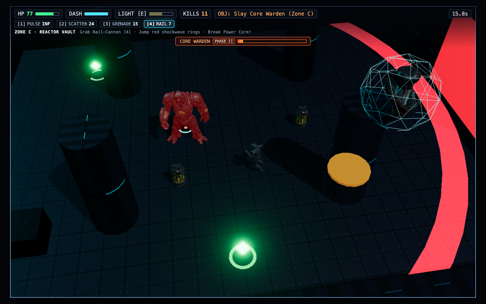
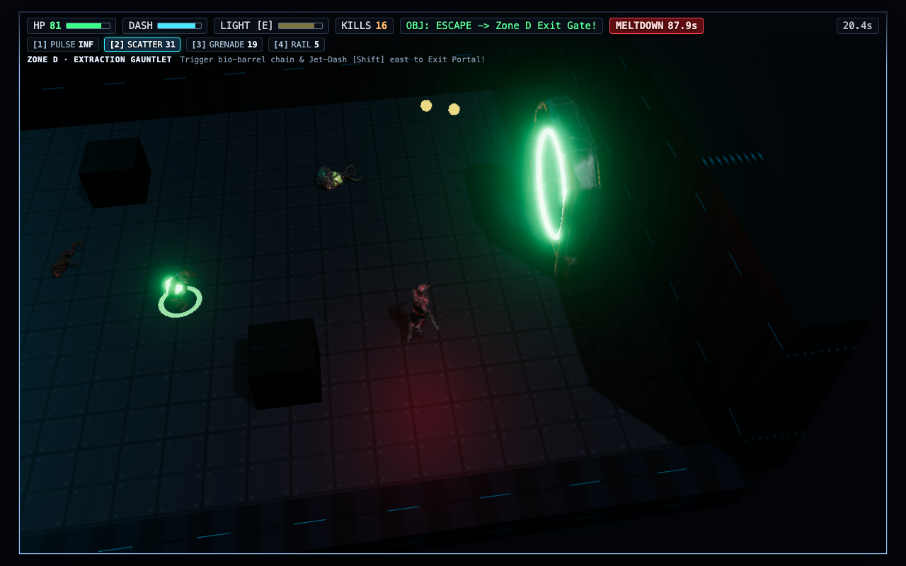
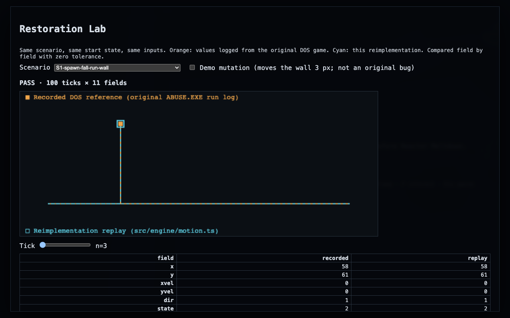

# REANIMATOR

> Kiroween 2026 · 1995 DOS *Abuse* 셰어웨어의 이동 물리를 실제 실행 로그로 검증해 복원하고, 같은 프로젝트 안에서 새로 설계한 풀 3D 쿼터뷰 트윈스틱 슈터로 확장한다.

두 개의 층으로 구성된다.

| 층 | 내용 | 틱 | 검증 방식 |
|---|---|---|---|
| **Restoration (복원)** | 원본 `ABUSE.EXE` 실행에서 얻은 수치 로그와 `src/engine/motion.ts` 재현 결과를 비교 | 15 Hz (설계값. 원본 틱은 미측정) | S1·S2·S3 + sealed holdout `M05`, 11개 필드 exact 비교 (`reference/fixtures/scenarios.json`) |
| **New Design (신규)** | Full 3D 쿼터뷰 트윈스틱 슈터. 4개 구역, 4종 무기, 보스 `Core Warden`, 원자로 Meltdown 탈출 | 60 Hz 결정적 시뮬레이션 (`src/game3d/world3d.ts`) | 단위 테스트 + 봇 완주(`tools/game/playthrough.ts`) + headless Chrome 스모크 |

**Restoration Lab**은 타이틀 화면의 `Restoration Lab` 버튼(오버레이 `#lab`)으로 연다. 원본 실행 로그와 엔진 재생 결과를 틱 단위로 나란히 보여 준다. "Demo mutation" 체크는 벽을 3 px 옮겨 비교기가 불일치를 잡는지 보여 주는 데모이며 원본 버그가 아니다.

## 갤러리

`docs/evidence/g4_playable/`에 `node tools/smoke/capture-showcase.ts`가 1280×800으로 생성한다.

| | |
|---|---|
|  |  |
| 01 타이틀 | 02 Zone A 조준(레이저 사이트·헤드램프) |
|  |  |
| 03 캣워크, 수류탄과 바이오 배럴 | 04 Core Warden 충격파 |
|  |  |
| 05 Meltdown 탈출 | 06 Restoration Lab |

## 조작

| 입력 | 동작 |
|---|---|
| `W` `A` `S` `D` / 방향키 | 8방향 이동 |
| 마우스 이동 | 조준 (커서를 월드에 레이캐스트) |
| 좌클릭 | 발사 |
| `Space` | 점프 |
| `Shift` / 우클릭 | Jet-Dash |
| `F` | 상호작용 |
| `E` | 헤드램프 토글 |
| `1` `2` `3` `4` | Pulse Rifle / Scattergun / Grenade / Rail-Cannon (획득 후 선택 가능) |
| `Q` / 마우스 휠 | 무기 순환 |
| `Esc` / `P` | 일시정지 |
| `R` | 재시작 |

## 빠른 시작

Node `>=26.12.1`이 필요하다 (`package.json` engines). `Makefile`은 `.tools/node-v26.13.1-darwin-arm64`의 프로젝트 전용 Node를 쓰도록 고정되어 있어, 해당 경로가 없으면 `make` 타깃 대신 `npm`/`node` 명령을 직접 쓴다.

```bash
npm install
npm run dev                       # Vite 개발 서버
```

## 검증 명령

```bash
make check                        # typecheck, node --test, reference-verify, reach, build, dist-guard
make reference-holdout            # sealed holdout 판정. 엔진 리비전당 1회, 결과로 엔진을 튜닝하지 않는다
node tools/game/playthrough.ts    # 봇이 구역 A–D, 보스, 탈출까지 결정적으로 완주
make smoke-local                  # build 후 headless Chrome 스모크 (tools/smoke/smoke.ts)
node tools/smoke/capture-showcase.ts   # dist/ 필요(먼저 make check). 갤러리 PNG 6장 재생성
```

참고: `capture-showcase.ts`는 실행 시작 때 `docs/evidence/g4_playable/`의 기존 `.png`를 모두 지운 뒤 위 6개 파일을 생성해 저장한다.

## 리깅된 Meshy 자산

`reference/manifests/meshy-assets.json`(schema `reanimator-meshy-assets-v2`) 기준. 모두 신규 설계이며 Abuse 원본과 무관하다. 모델은 Meshy 7.1로 생성하고 `tools/meshy/optimize-rigged.ts`(리깅 GLB) 및 `tools/meshy/optimize-glb.ts`(프롭 GLB)로 Meshopt + WebP 512 최적화를 거쳐 `public/assets/models/`에 둔다. 매니페스트의 license 필드는 `Private`이다.

| ID | 역할 | Rig | 클립 | 최적화 크기 | 삼각형 |
|---|---|---|---|---|---|
| `operative` | 플레이어 | 66 joints | idle, walk, run, jump, attack, death | 2,131,000 B | 10,344 |
| `warden` | 보스 Core Warden | 66 joints | idle, walk, run, attack, death | 4,186,512 B | 31,061 |
| `bio-stalker` | 추격형 적 | 66 joints | idle, walk, run, attack, death | 3,093,224 B | 30,974 |
| `pulse-rifle` | 무기 소품 | 없음 | 없음 | 562,032 B | 8,332 |
| `bio-barrel` | 폭발 배럴 | 없음 | 없음 | 474,200 B | 7,500 |
| `crawler` | Skitter-Husk 근접 적 | 없음 | 없음 | 596,704 B | 11,992 |
| `spitter` | Spore-Sentinel 원거리 적 | 없음 | 없음 | 608,696 B | 12,000 |
| `power-core` | 원자로 코어 | 없음 | 없음 | 600,268 B | 10,000 |
| `exit-gate` | 탈출 에어록 | 없음 | 없음 | 1,275,864 B | 21,774 |

Meshy 원본 GLB(`assets/meshy-raw/`, 수십 MB)는 `.gitignore`로 제외된다. 사운드는 파일 없이 WebAudio로 절차 합성한다(`src/ui/audio.ts`).

## R3.3 헤드램프 격리

헤드램프(`E`)의 상태 `w.light`는 렌더링과 HUD에서만 읽는다. 이동, 전투, 픽업, 위험 지형, 적에는 영향을 주지 않는다. `tests/game3d.test.ts`가 이를 확인한다. 한 월드는 360틱 동안 램프를 켜고 끄고, 다른 월드는 켜지 않은 채 같은 입력을 주고, `light` 필드를 제외한 전체 상태가 `deepEqual`로 같아야 하며 배터리 값만 달라야 한다. 2D 쪽 동일 불변식은 `tests/game.test.ts`에 있다.

## IP 가드와 저장소 범위

- `tools/release/check-dist.ts`(`make check`의 `dist-guard` 단계)가 `dist/`를 `reference/manifests/abuse-source.json`의 원본 파일 해시·파일명과 대조한다. 추가로 허용 확장자 밖의 파일, `MZ` 실행 헤더, DOS/4G extender 배너가 있으면 실패한다.
- 원본 실행 파일, 원본 파생물(`reference/work/`, `reference/derived/`, `reference/private/`), 원본 화면 캡처와 명령 덤프는 `.gitignore`로 제외된다. 목록과 근거는 `docs/reference/ASSET_REGISTER.md`.
- 원본 `LICENSE.TXT` §1은 역공학과 파생물을 제한한다. 이 프로젝트는 원본 코드·데이터를 배포하지 않으며, 법률 자문이 아니다.
- `reference/fixtures/`, `reference/holdout/`, `reference/harness/`, `reference/manifests/`는 공개 후보로 추적된다. 원본 수치 로그만 담고 원본 자산은 없다.

## 한계

- 15 Hz는 설계값이다. 원본 틱 레이트는 측정하지 않았다.
- 복원 범위는 이동 물리(S1–S3, M05)다. 3D 슈터 부분은 원본 로직의 복원이 아닌 신규 설계다.
- 봇 완주는 결정적 입력 기준이며 사람 플레이 시간·난이도는 검증하지 않았다.

## 라이선스

[MIT](LICENSE). 원본 *Abuse* 파일은 포함되지 않으며 이 라이선스의 대상이 아니다.
