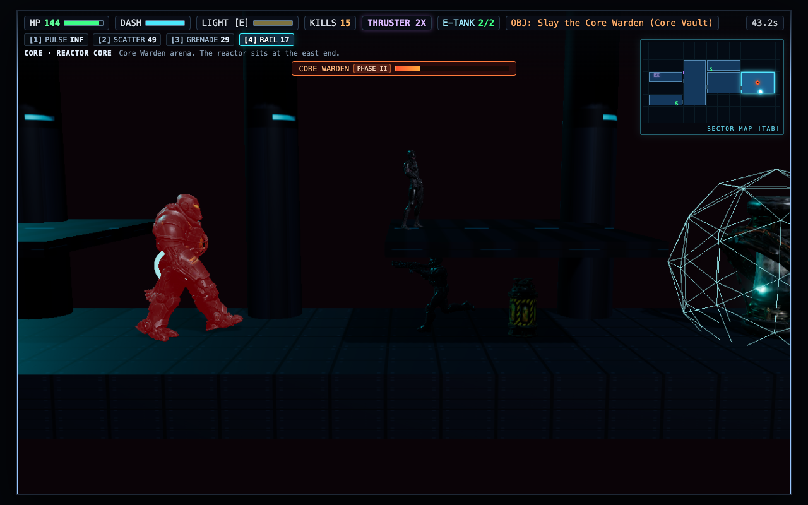
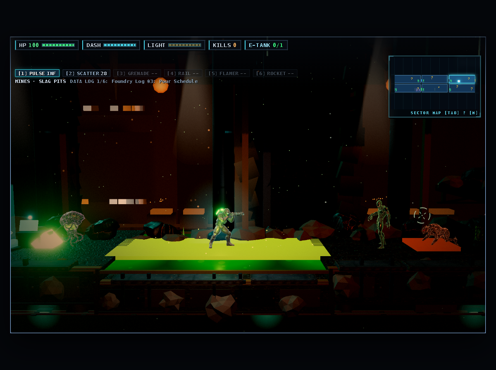
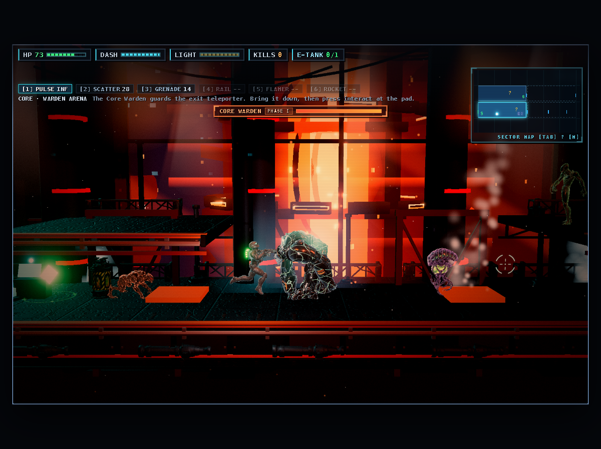
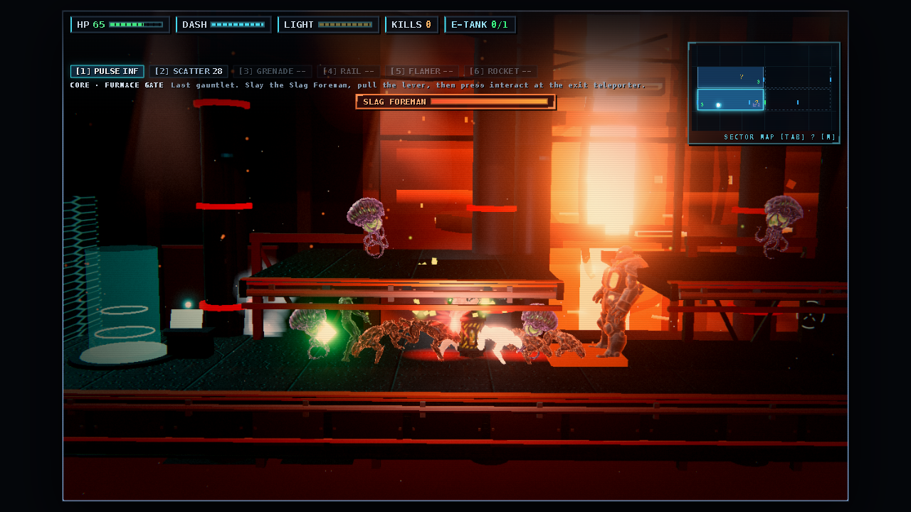
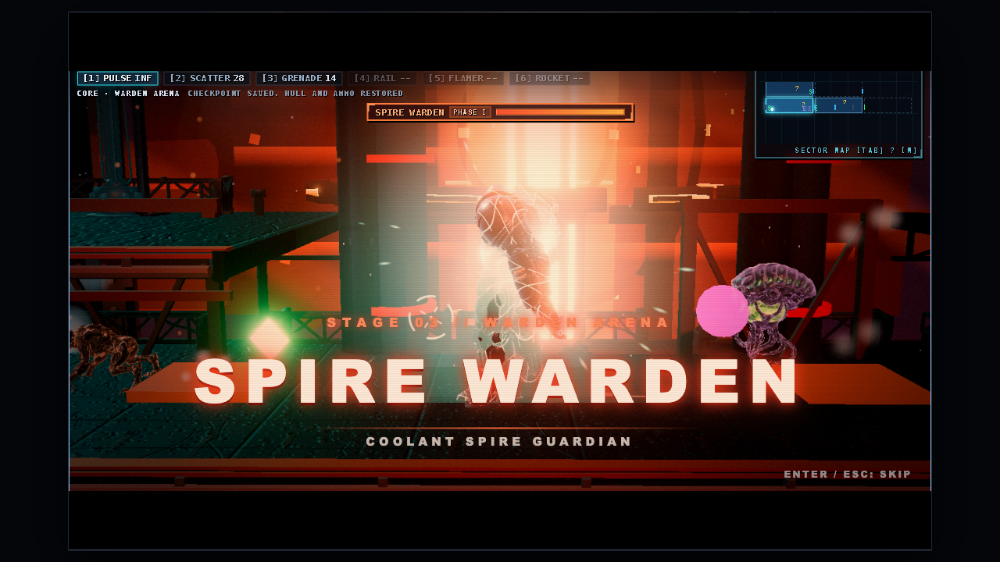
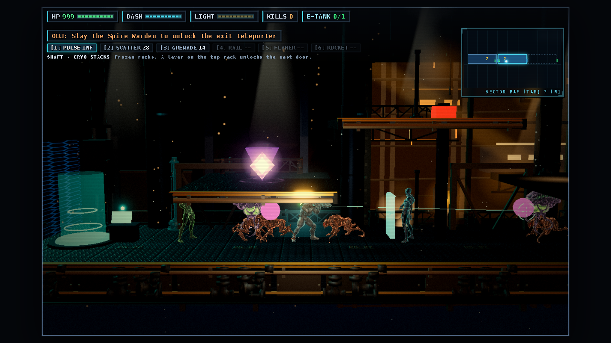

# REANIMATOR


**A 3D side-view sci-fi metroidvania that runs in your browser, built on movement physics restored from the 1996 DOS game *Abuse*.**

You wake in a sealed cryo station. Something below keeps the reactor burning. Reach the core, break it, and get out. Then take the Foundry Line and the Reactor Spire.

## Features

- **Three stages.** Stage 1 is a six-sector cryo facility with locked doors, hidden walls, ability gates, the three-phase Core Warden and a Meltdown escape with three endings. Stage 2 (Foundry Line) ends with the Slag Foreman mini-boss. Stage 3 (Reactor Spire) adds Cryo Bulwarks, frost-shielded stalkers that shrug off Pulse and Scattergun fire from the front, and ends with the Spire Warden. Stages unlock in order and keep best times.
- **Metroid-style abilities:** Thruster Boots (double jump), Crawl Slide, Blast Core, Scan Lens, Thermal Plating and Energy Tanks.
- **Six weapons** (Pulse, Scattergun, Grenade, Rail-Cannon, Flamer, Rocket), a dash with brief invulnerability, a melee counter and a scan pulse.
- **Per-stage sound.** Music, ambience and effects are synthesised at runtime. Each stage re-voices the sector themes: the Foundry is lower and slower with anvil hits, the Spire is colder and brighter with glassy arpeggios.
- **Classic View** (press `V`): a 320x200, 256-colour dithered look with an optional CRT filter.
- **Physics lab** (Extras menu): the original *Abuse* movement log and this engine's replay side by side, with a mutation mode that shows the check failing when one constant changes.
- Assist options, reduce flashing, gore level, three difficulties and a skippable tutorial you can replay.

## Screenshots

| Stage 1: Cryo Facility | Stage 2: Foundry Line | Stage 3: Reactor Spire |
|---|---|---|
|  |  |  |

| Slag Foreman wind-up | Spire Warden intro | Cryo Bulwark frost shield |
|---|---|---|
|  |  |  |


## Controls

| Key | Action |
|---|---|
| `A` `D` | Run |
| `W` / `Space` | Jump (twice with Thruster Boots) |
| `S` | Drop through grates |
| `Shift` | Dash |
| `Ctrl` | Sneak |
| Mouse, left click | Aim and fire (hold to charge the Rail-Cannon) |
| `1`-`6` / `Q` | Weapons |
| `E` | Headlamp |
| `X` | Counter |
| `Z` | Scan pulse |
| `F` | Save station or console |
| `Tab` | Sector map |
| `V` | Classic View |
| `Esc` | Pause (full controls and settings) |

## The Abuse restoration, and what it covers

The project started as a reverse-engineering exercise on the *Abuse* DOS shareware 1.05 binary. The player movement physics (run, jump, gravity, wall contact) were rebuilt in `src/engine/motion.ts` from binary analysis, the game's Lisp scripts and recorded runs of the original. The engine replays three development scenarios and one sealed holdout scenario with an exact match on all 11 measured fields per frame. The 15 Hz tick is a design value; the original tick rate was not measured.

That is the whole scope of the restoration. The 3D game is new design: the levels, enemies, weapons, bosses, art, music and the 60 Hz 3D movement in `src/engine/motion3d.ts` are original work. No *Abuse* code, data or assets ship in the build, and a release check (`tools/release/check-dist.ts`) fails the build if any do. The verification rules are in [docs/reference/VERIFICATION_CONTRACT.md](docs/reference/VERIFICATION_CONTRACT.md).

## System requirements

A desktop browser with WebGL2 (current Chrome, Edge, Firefox or Safari), a keyboard and mouse, and a GPU from the last ten years.

## Run from source

Node 26.12.1 or newer is required.

```bash
npm install
npm run dev        # development server at http://localhost:5173
npm run build      # production build in dist/
make check         # type check, unit tests, bot playthroughs, reachability, build, dist guard
make release       # runs all checks, then writes release/reanimator-<version>-web.zip
```

Production builds do not expose debug hooks. Add `?debug=1` to the URL to enable them for testing.

## Tests

`make check` runs the TypeScript check, about 740 unit tests, the movement replays against the original logs, deterministic bot playthroughs of all three stages on every difficulty, reachability checks for every gate and secret, a production build and the dist guard. The simulation is deterministic, so bot results are pinned to the tick.

## How it was built

Development used Kiro (spec-driven tasks, steering rules and agent hooks) for planning, implementation and the verification gate; see [docs/KIRO_USAGE.md](docs/KIRO_USAGE.md). Character and prop models were generated with Meshy.

## Credits and licenses

Built with TypeScript, Three.js (MIT), Vite and WebAudio. Music and effects are synthesised at runtime. The run-and-gun feel nods to *Abuse* (1996); no assets from that game are included. Code is MIT licensed, see [LICENSE](LICENSE). Release notes are in [CHANGELOG.md](CHANGELOG.md).
