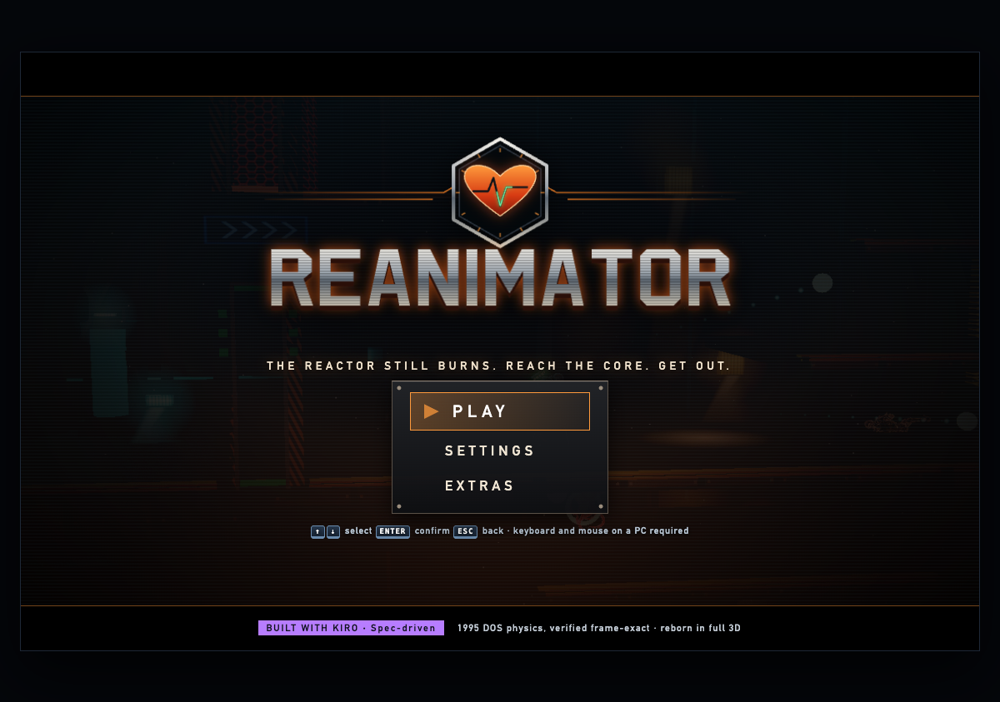
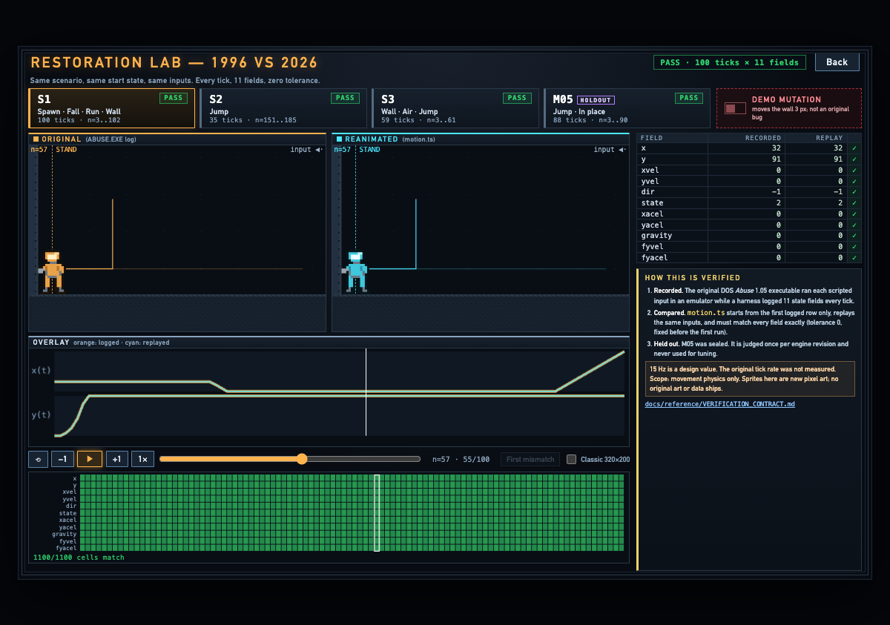
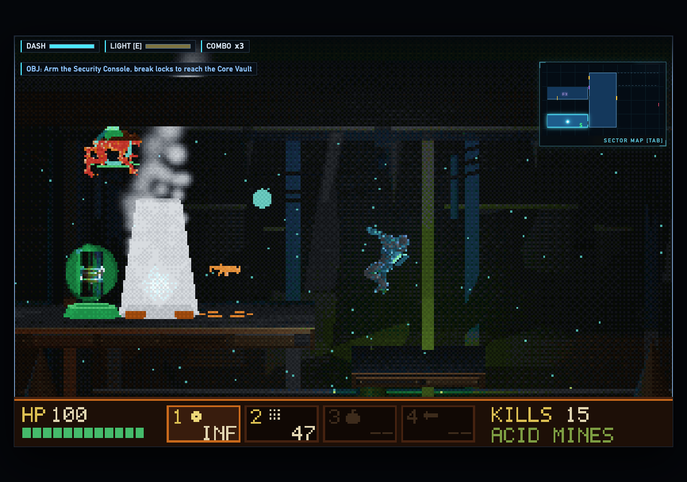
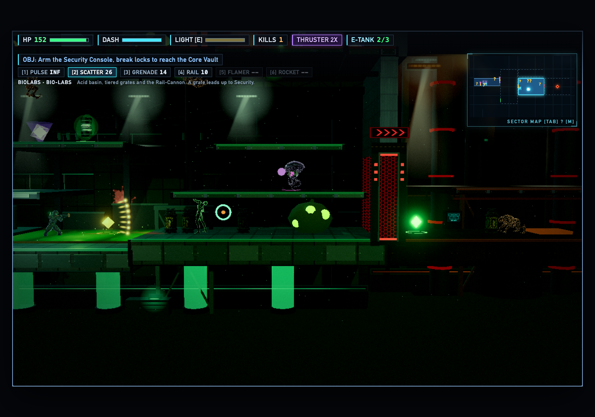
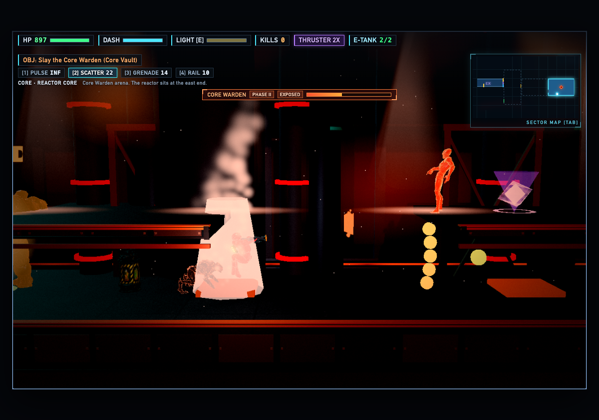
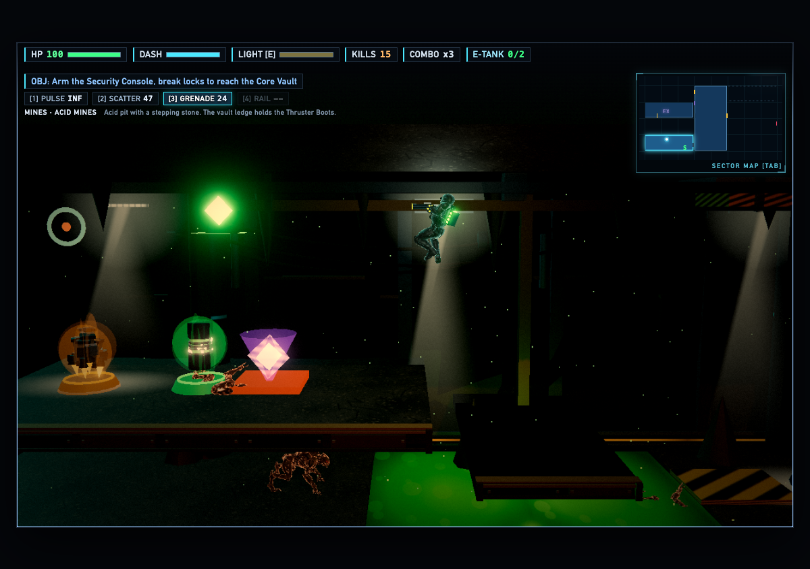
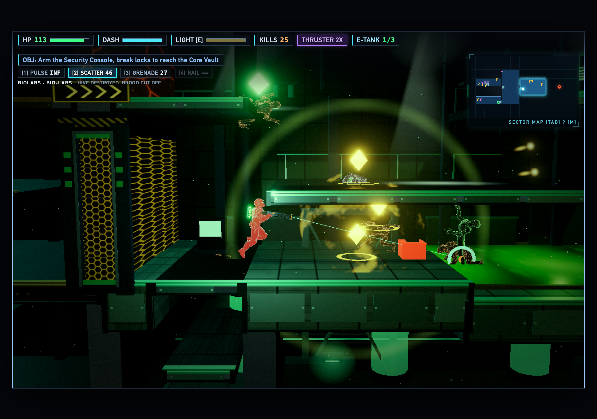
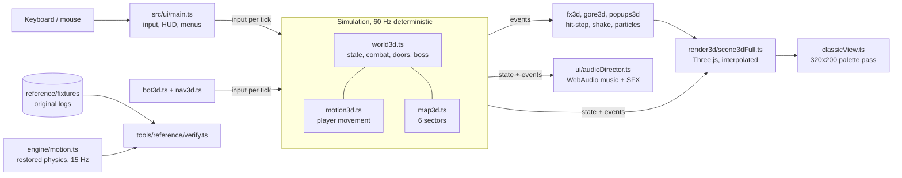

# REANIMATOR



**A 1996 DOS shooter's movement physics, reverse-engineered and verified frame by frame, then reborn as a 3D side-view metroidvania that runs in your browser.**

Built for AWS Kiroween 2026 with [Kiro](#built-with-kiro). TypeScript, Three.js, no game engine, no original assets.

[Judges' guide (3-minute demo)](docs/JUDGES.md) · [How Kiro was used](docs/KIRO_USAGE.md)

## What is this

REANIMATOR has two layers in one repository.

| Layer | What it is | How it is checked |
|---|---|---|
| **Restoration** | A TypeScript re-implementation of the movement physics of the *Abuse* 1.05 DOS shareware (`src/engine/motion.ts`). | Compared against numeric logs captured from the original running binary: scenarios S1, S2, S3 and a sealed holdout M05, 11 fields each, exact match (`reference/fixtures/scenarios.json`). |
| **New design** | A 3D side-view metroidvania: 6 sectors, ability-gated doors, a 3-phase boss, an escape sequence, procedural music, and a switchable 1996-style Classic View. | 60 Hz deterministic simulation (`src/game3d/world3d.ts`), unit tests, a bot that plays the whole game, reachability checks, and browser smoke tests. |

Open **Title > Extras > Restoration Lab** to see the original logs and the engine replay side by side, tick by tick.



## 1996 → 2026

*Abuse* (Crack dot Com, 1996) is a side-scrolling run-and-gun with a dark, gritty look. We wanted its movement to feel the same, so we measured it instead of guessing. The steps were:

1. **Acquire and register the original.** The shareware 1.05 package is hashed and listed in `reference/manifests/abuse-source.json`. Rights and format findings are in [`docs/reference/ASSET_REGISTER.md`](docs/reference/ASSET_REGISTER.md) and [`docs/evidence/G0_REPORT.md`](docs/evidence/G0_REPORT.md).
2. **Analyse the binary.** The executable is a DOS/4GW LE file. It was converted for analysis, and Ghidra (through the REA toolchain, 1,544 recovered procedures) was used to find the mover code paths. Report: [`docs/evidence/G1_REPORT.md`](docs/evidence/G1_REPORT.md).
3. **Observe, don't assume.** An observation harness (`reference/harness/`) runs scripted input inside the original game and dumps per-tick state. Each scenario was captured three times with identical hashes.
4. **Re-implement and compare.** `src/engine/motion.ts` is judged by `tools/reference/verify.ts` against those logs. The first holdout (M04) failed. The cause was found in the binary and the engine was fixed. M04 was then moved to development and a fresh sealed holdout, M05, was written down and passed. The failure is recorded in [`docs/evidence/G2_REPORT.md`](docs/evidence/G2_REPORT.md).
5. **Build something new on top.** The 3D game uses its own movement code (`src/engine/motion3d.ts`) and is **not** a restoration.

### What is and is not restored

- **Restored and verified:** movement physics, as exercised by S1, S2, S3 and M05.
- **Design value, not measured:** the 15 Hz tick of the restored engine. The original's tick rate was not measured.
- **New design:** everything in the 3D game (sectors, enemies, weapons, boss, audio, art, Classic View).
- **Not included:** the original executable, data, art, sound, or captures. `dist-guard` fails the build if any show up in `dist/`.

The verification rules are in [`docs/reference/VERIFICATION_CONTRACT.md`](docs/reference/VERIFICATION_CONTRACT.md).

## How to play

Node `>=26.12.1` is required (`package.json` engines).

```bash
npm install
npm run dev        # Vite dev server, open the printed URL
```

| Key | Action |
|---|---|
| `A` `D` | Run |
| `W` / `Space` | Jump (twice with Thruster Boots) |
| `S` | Drop through grates |
| `Shift` / right click | Dash (invulnerable frames) |
| Airborne `Shift` + `S` | Stomp |
| Mouse | 360° aim |
| Left click | Fire. With the Rail-Cannon, hold to charge and release |
| `1` to `6` / `Q` | Pulse, Scattergun, Grenade, Rail-Cannon, Flamer, Rocket launcher |
| `E` | Headlamp |
| `F` | Save station / console |
| `Tab` | Sector map |
| `V` | Toggle Classic View (1996 look) |
| `C` | On the result screen after dying: return to your last save |
| `Esc` | Pause |

Walls slow your fall when you press into them in the air, and wall jump needs the Thruster Boots. Details and numbers: [`docs/R1_GAMEPLAY.md`](docs/R1_GAMEPLAY.md).

## Highlights

- **Metroidvania structure.** Six sectors (Cryo Airlock, Central Transit Shaft, Sunken Mines, Bio-Labs, Upper Security Deck, Core Vault). Doors are locked by weapon type (blue Pulse, green Scattergun, yellow Grenade, red Rail-Cannon plus console). Thruster Boots open two 4.4 m height gates. Energy Tanks add +30 max HP. Two secret Cracked Bio-Walls.
- **Core Warden boss.** Three phases with telegraphed attacks, a weak-point window, an intro cinematic, and damage numbers. See [`docs/R2_BOSS.md`](docs/R2_BOSS.md).
- **Combat depth.** Wall jump, dash cancel, stomp, per-weapon enemy matchups, kill combos that refund your dash, rail charge. See [`docs/R1_GAMEPLAY.md`](docs/R1_GAMEPLAY.md).
- **Abuse-style enemies.** Ceiling droppers, wall and ceiling climbers, hive spawners, swarm flanking. See [`docs/R3_FOES.md`](docs/R3_FOES.md).
- **Classic View.** Press `V` for a 320x200, 256-colour dithered, orthographic look with an optional CRT filter and a pixel HUD. The palette, font, and icons are original work. No Abuse data was read or copied. See [`docs/R3_CLASSIC.md`](docs/R3_CLASSIC.md).
- **Six weapons (R6).** The Flamer (slot 5, cone, sets enemies burning) and the Rocket launcher (slot 6, accelerating, area blast, a capped rocket jump that cannot bypass the Thruster Boots gates) sit on pedestals in the Mines and the Security Deck. See [`docs/R6_ARMS.md`](docs/R6_ARMS.md).
- **Sector vistas (R7).** Each sector has openings in the back wall with its own distant scene: a cryo hall, a vertical shaft, a drill machine and cave, giant specimen tanks, a skyline with searchlights, and the reactor core. About four extra draw calls per sector. See [`docs/plans/R7_SOAK.md`](docs/plans/R7_SOAK.md) for the stability pass.
- **Camera framing (R7).** The camera clamps to the current room, keeps the player near 42% of screen height, applies per-sector hints, and zooms 0.92 to 1.28 with nearby threats. It widens for the boss fight.
- **UI layers (R7).** A z-index scale and a panel stack contract keep Extras, Lab and Revived above the title. `await __reanimatorUiAudit()` checks every panel's controls with `elementFromPoint`.
- **R12.** Extraction hatch and pickup visuals, new reticle, per-sector grading, enemy pose motion, a gentler first airlock encounter, always-resumable defeat, and a smarter bot. `make check` exit 0, 568 of 568 tests, bot Normal 5444 ticks. See [R12_LOOK](docs/R12_LOOK.md), [R12_MOTION](docs/R12_MOTION.md), [R12_ONBOARD](docs/R12_ONBOARD.md), [R12_ROBUST](docs/R12_ROBUST.md).
- **R11.** Hunter armour on rig bones, opening HUD fade-in with letterbox and title card, showcase and pause fixes, English UI chrome. See [`docs/R10_HUNTER.md`](docs/R10_HUNTER.md) and [`docs/R10_OPENING.md`](docs/R10_OPENING.md).
- **R10.** Cinematic opening, Classic View audit and CRT transition, Warden counter and escape set pieces, Bio-Labs Hunter zone. See [`docs/R10_HUNTER.md`](docs/R10_HUNTER.md).
- **R9.** Melee Counter (`X`/`C`) and Scan Pulse (`Z`), a lean-to-open fake wall with a Vault Nook secret, magnetised chunky pickups, per-sector set dressing and a draw-call budget. See [`docs/R9_PARRY.md`](docs/R9_PARRY.md).
- **R8.** Restoration Lab redesign (scenario cards, split view, overlay, step controls, match heatmap). Story/Normal/Hard difficulty with assist options and a death-cause line. Six data logs (EN/KO), three endings and a credits roll. Per-actor GPU resource disposal. See [`docs/R8_ASSIST.md`](docs/R8_ASSIST.md).
- **Stability (R7).** Level swaps free static meshes and textures, the frame loop is guarded, WebGL context loss is handled, and `await __reanimatorSoak(3, { showcase: false })` reports leaking counters.
- **R13.** Judge Reel, ambient sector life, Warden readability, per-weapon impacts, truthful debug layers, and smoother enemy running: the sim no longer teleports queued foes (max 0.18 m per tick on the bot run, was 0.79 m) and the display keeps the sim speed. `make check` exit 0, 625 of 625 tests, bot Normal 5208 ticks. See [R13_UX](docs/R13_UX.md), [R13_COMBAT](docs/R13_COMBAT.md), [R13_ALIVE](docs/R13_ALIVE.md).
- **R15.** Eleven Meshy-generated terrain pieces (wall panels, grates, pillars, pipes, girders and more) are instanced across all six sectors on top of the R14 procedural terrain. Visual only; draw calls stay at or under 300 (observed 148 to 299) with no console errors in a Playwright run. Not human-playtested. See [`docs/R15_MESHY_TERRAIN.md`](docs/R15_MESHY_TERRAIN.md).
- **R14.** Slower room transitions (42-tick door walk-through, 150-tick entry grace, sector title card), procedural terrain detail (textures, normal maps, relief meshes; Meshy was unreachable), and per-kind character lighting so characters read as shapes. Render-only for terrain and light; bot results unchanged. Verified by `make check` (649/649) and a no-error browser run, not by a human playtest. See [`docs/R14_TRANSIT.md`](docs/R14_TRANSIT.md), [`docs/R14_TERRAIN.md`](docs/R14_TERRAIN.md), [`docs/R14_CHARLIGHT.md`](docs/R14_CHARLIGHT.md).
- **Judge Reel (R13).** `Extras` > `Judge Reel`, `/?reel` or `__reanimatorReel()` plays a 90-second captioned reel of live engine cuts, skippable with any key. See [`docs/R13_REEL.md`](docs/R13_REEL.md).
- **Demo tour and showcase (R6).** `Extras` has a Demo tour of 11 fixed checkpoints and a one-minute captioned Showcase reel, both on the real game loop. See [`docs/JUDGES.md`](docs/JUDGES.md).
- **Item fanfares and sound pass (R6).** Five pickup fanfares, dedicated recipes for hazards, hives and the new weapons, proximity loops near live hazards, and an escape music that speeds up as the hatches close. See [`docs/R6_SOUND.md`](docs/R6_SOUND.md).
- **Enemy rigs (R5).** Stride-locked gaits, pose channels, boss attack patterns, secondary motion, distance LOD. See [`docs/R5_RIG.md`](docs/R5_RIG.md).
- **Metroid systems (R5).** Crawl Slide through two tunnels, three breakable blocks, six map terminals that reveal the minimap (`M`), extra Energy Tanks and Ammo Expansions, and an escape hatch that shuts during the Meltdown. See [`docs/R5_METROID.md`](docs/R5_METROID.md).
- **Combat VFX (R5).** Short warm-white hit flash, glowing projectiles, capped chromatic kick, stacked damage popups, death pop, rail ready ring, scatter shock wave. Mesh merging and a soft steam shader keep draw calls down. See [`docs/R5_RENDER.md`](docs/R5_RENDER.md).
- **Mood.** Scripted lighting, gore chunks and decals, smoke, per-sector grading.
- **Procedural audio.** Music and effects are synthesized with WebAudio at runtime (sectioned themes, boss phases, reverb, delay, sidechain). No audio files. See [`docs/R2_AUDIO.md`](docs/R2_AUDIO.md).
- **Game feel.** Hit-stop, trauma screen shake, camera rig, pooled particles, kill slow-motion.
- **Attract mode.** The title screen plays the bot through the game as a cinematic reel.

| | |
|---|---|
|  |  |
| Classic View (`V`) | Combat |
|  |  |
| Core Warden | Sunken Mines |
|  |  |
| Bio-Labs | Restoration Lab |

## Architecture

The simulation is deterministic and knows nothing about rendering. That is what lets a bot and the tests play the full game headlessly.



- Data flows one way from the simulation to the renderer, effects, and audio. They read state and events and never write back. The headlamp state `w.light` is HUD and renderer only, and `tests/game3d.test.ts` checks that it cannot change movement, combat, pickups, doors, saves, hazards, or enemies.
- The restored 15 Hz physics (`src/engine/motion.ts`) is a sealed module used by the Restoration Lab and the verifier.

## Verification

```bash
make check                       # tsc, node --test, reference-verify, reach + reach3d, build, dist-guard
make reference-holdout           # sealed holdout (once per engine revision, never used to tune)
make smoke-local                 # build, then headless Chrome smoke test (tools/smoke/smoke.ts)
node tools/game/playthrough.ts   # deterministic bot plays the whole game to the escape
```

Observed on `main` at `3c8e7a0` (R11): `make check` exit 0, 534 of 534 node tests, `reach3d` 52 waypoints (3,432 ticks). The figures in the next list are older (R8). Push to the remote and `make smoke-local` in a real Chrome are still pending.

- `make check` exit 0, 427 of 427 node tests, `reference-verify` 3 of 3 scenarios, `reach3d` 52 waypoints (3,432 ticks), `dist-guard` PASS on 13 files (14,775,872 B). The bot run and draw-call figures below predate R7 and are not re-measured.
- Bot run: won in 4,901 ticks with 126 of 160 HP and 50 kills.
- Draw calls per sector: 159 to 275 in Modern, 123 in Classic. Zero browser console warnings.

The `make` targets use the project-local Node in `.tools/`. If it is missing, run the same commands with your own Node (`node --test tests/`, `node tools/reference/verify.ts`, and so on).

## Built with Kiro

Kiro was the working environment for the whole project, not only for code generation. Each item links to the real file.

- **Spec-driven development.** Five specs, each with requirements, design, and tasks: [`abuse-reference`](.kiro/specs/abuse-reference/), [`restored-motion`](.kiro/specs/restored-motion/), [`reanimated-slice`](.kiro/specs/reanimated-slice/), [`full-3d-quarter-view`](.kiro/specs/full-3d-quarter-view/), [`metroidvania-3d`](.kiro/specs/metroidvania-3d/).
- **Steering.** [`.kiro/steering/reanimator.md`](.kiro/steering/reanimator.md) always loads the sealed-file list, the headlamp rule, and the "unverified unless observed" rule. Harness steering files such as [`harness-sync`](.kiro/steering/harness-sync.md) and [`harness-checkpoint`](.kiro/steering/harness-checkpoint.md) keep sessions resumable through short entry docs.
- **Hook.** [`.kiro/hooks/engine-gate-on-save.json`](.kiro/hooks/engine-gate-on-save.json) runs `make check` when the engine or verifier is saved. It fired four times in one session, all exit 0 (log in `docs/evidence/g2/hook_runs.log`).
- **Sealed files and a verification contract.** The engine, the 2D slice, the fixtures, and the holdout are protected, and expected values are never generated by the new engine. See [`docs/reference/VERIFICATION_CONTRACT.md`](docs/reference/VERIFICATION_CONTRACT.md).
- **Parallel sub-agent rounds.** Rounds R1 to R4 each ran four tracks in parallel git worktrees. An integration agent merged them and the orchestrator checked the result in a real browser with Playwright. That found bugs unit tests had missed: a combo pill kept hidden by CSS, a title wordmark collapsed to the SVG origin by a transform override, and an instanced door-lamp buffer sized for 7 lamps while 8 were written. Details in [`docs/KIRO_USAGE.md`](docs/KIRO_USAGE.md).
- **Honest records.** `docs/KIRO_USAGE.md` lists only what Kiro actually did, including what was not done. For example, the REA MCP server was verified from the command line but could not be wired into Kiro's settings.

## Assets, credits, and licensing

- The 3D models are generated with Meshy 7.1 and optimized with the scripts in `tools/meshy/` (register: [`docs/reference/ASSET_REGISTER.md`](docs/reference/ASSET_REGISTER.md), manifest: `reference/manifests/meshy-assets.json`). Sound and music are synthesized at runtime.
- **No original *Abuse* assets are included.** `tools/release/check-dist.ts` (the `dist-guard` step of `make check`) compares `dist/` against the original file hashes and names, and rejects unexpected extensions, `MZ` executable headers, and DOS/4G banners.
- Original executables, derived analysis files, and original screen captures are listed in `.gitignore` and are not published. The original license restricts reverse engineering and derivative works. This project does not distribute original code or data. This is not legal advice.
- *Abuse* was created by Crack dot Com. REANIMATOR is an independent project and is not affiliated with or endorsed by its authors.
- Code: [MIT](LICENSE). The MIT license does not cover the original *Abuse* files.

## Limits

- Restoration covers movement physics only. The 15 Hz tick is a design value.
- The bot plays deterministically and says little about human difficulty. Human play observation is not done yet.
